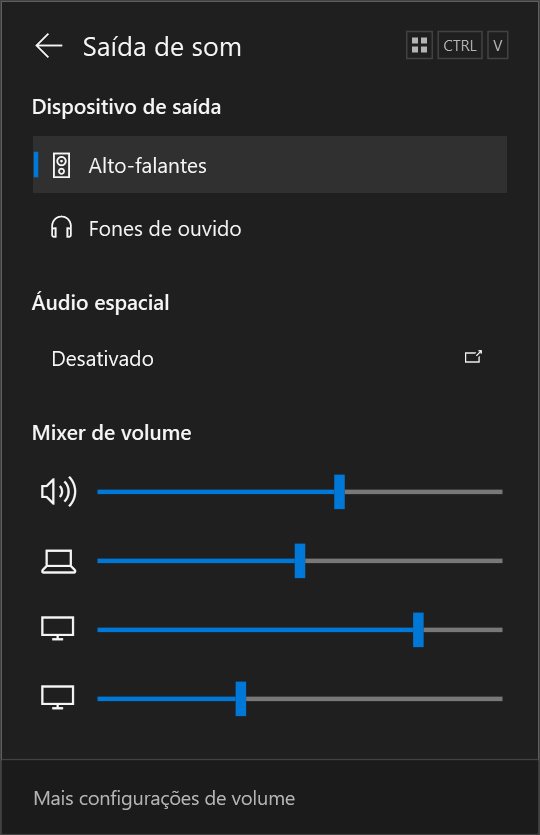

# VolumeDock

**Windows 11's sound-output layout, with the look and feel of Windows 10.**

VolumeDock puts output devices, master volume, and per-app sliders in one compact panel. Open it from the existing Windows volume icon or press **Ctrl + Win + V**.

[Download a release](https://github.com/AndreMontz/VolumeDock/releases) · [Report an issue](https://github.com/AndreMontz/VolumeDock/issues)



*Preview with representative devices and audio sessions. The interface is in Brazilian Portuguese.*

## What it does

- Switch between connected output devices with one click. The selected device becomes the default for normal playback and communications.
- Adjust master volume and the audio sessions on the selected output. Click an app's icon to mute or unmute it; hover to see its name and volume.
- Keep the familiar Windows 10 colors, square edges, sliders, and optional transparency. The panel follows the system theme and accent color when started.
- Open from the native taskbar volume icon, without an additional tray icon. The original right-click menu remains available.
- Toggle the panel with **Ctrl + Win + V**. Dismiss it by clicking outside, pressing **Esc**, or clicking the back arrow.
- Hear a short Windows sound when changing master volume or System Sounds. App sliders remain silent.
- See the selected output's spatial-audio status and open Windows sound settings to change it.

The interface is currently in **Brazilian Portuguese (pt-BR)**. This README is in English.

## Install

Download **`VolumeDock-1.0.0-Setup-x64.exe`** from [Releases](https://github.com/AndreMontz/VolumeDock/releases) and run it. Follow the installer to choose the installation location and startup options.

For a portable copy, download **`VolumeDock-1.0.0-Portable-x64.zip`**, extract the entire archive to a writable folder, and run **`VolumeDock.exe`**. Keep the included license files with the application.

**Requirements:** Windows 10 x64, version 1809 or later, with [.NET Framework 4.8](https://dotnet.microsoft.com/download/dotnet-framework/net48) or later and the Windows volume icon enabled. Tested on Windows 10 22H2. Windows 11 and 32-bit Windows are not supported targets for this release.

The installer works for the current user without administrator access. Starting with Windows is selected by default. Uninstall from Windows **Settings → Apps → VolumeDock**, or use the Start menu uninstall shortcut. Exiting or uninstalling immediately restores the native volume icon's behavior.

## Use

1. Start VolumeDock.
2. Click the Windows volume icon or press **Ctrl + Win + V**.
3. Select an output device, drag a slider, or click an app icon to toggle mute.

The mixer displays existing audio sessions on the default output. An app may need to play audio once before it appears. Apps configured to use a different output remain on that output; VolumeDock does not change per-app routing.

The spatial-audio row reads the actual Windows configuration. Clicking it opens native sound settings. To change Windows Sonic or another spatial format, use the output device's properties in Windows. VolumeDock does not simulate a spatial-audio selection.

## Command line

Run these commands from the folder containing the executable:

```powershell
.\VolumeDock.exe              # Start in the background
.\VolumeDock.exe --toggle     # Open or close the panel
.\VolumeDock.exe --quit       # Exit; native volume behavior returns
.\VolumeDock.exe --disable    # Exit and remove VolumeDock's startup shortcut
```

Only one instance runs at a time. `--disable` keeps the application files so you can start it again later. Use the installer uninstaller to remove an installed copy.

## Build from source

The application uses C# 5, WPF, and the .NET Framework compiler supplied with Windows. No NuGet packages are required.

From the repository root, run:

```powershell
.\scripts\build.ps1
```

To generate release packages, install [Inno Setup](https://jrsoftware.org/isinfo.php) and run:

```powershell
.\scripts\package.ps1
# If Inno Setup is installed elsewhere:
.\scripts\package.ps1 -InnoCompiler 'C:\Tools\Inno Setup\ISCC.exe'
```

The installer specification is in [`installer/VolumeDock.iss`](installer/VolumeDock.iss).

The executable is written to `build/`; the installer, portable ZIP, and `SHA256SUMS.txt` are written to `dist/`. To render the documentation preview without accessing the computer's audio devices, run `build\VolumeDock.exe --render-demo docs\images\panel.png`.

## Troubleshooting

**The native volume panel still opens.** Make sure VolumeDock is running and the Windows volume icon is visible. If you use another volume replacement or a custom taskbar, close it while checking VolumeDock. Restart VolumeDock after changing its installation location.

**An app is missing.** Play audio in the app and check that it uses the selected output. Expired sessions are removed automatically.

**Spatial audio is unavailable.** Availability depends on the output device, driver, and installed spatial-audio providers. VolumeDock reports the state returned by Windows and opens its native settings for changes.

**Windows shows an unknown-publisher or SmartScreen prompt.** The current installer is unsigned. Download it from this repository's Releases page and compare its SHA-256 with the release checksum file before running it.

**A problem persists.** Local status files and error logs are stored in `%LOCALAPPDATA%\VolumeDock`. When opening an issue, include your Windows build, display scaling, taskbar position, and steps to reproduce. Review logs and screenshots before sharing them: they can contain local paths or device names.

## How it works

VolumeDock uses Windows Core Audio for device enumeration, volume, mute, and session controls. Its spatial-audio status comes from the public Windows Runtime API. Lightweight keyboard and mouse hooks recognize the shortcut and clicks on the existing volume icon; exiting releases those hooks. It does not inject code into Explorer or install an audio driver.

VolumeDock does not upload telemetry. The application runs locally and writes diagnostic files only to its local application-data folder.

## License and credits

Original VolumeDock code is licensed under the [MIT License](LICENSE). Adapted Core Audio interop definitions come from [EarTrumpet](https://github.com/File-New-Project/EarTrumpet) and retain its license, including its excluded-entity terms. See [Third-party notices](THIRD_PARTY_NOTICES.md) and [`licenses/EarTrumpet.txt`](licenses/EarTrumpet.txt) for the exact terms.

The layout is inspired by Microsoft's [Windows 11 volume mixer](https://blogs.windows.com/windows-insider/2023/03/02/announcing-windows-11-insider-preview-build-25309/). VolumeDock is an independent project and is not affiliated with Microsoft or EarTrumpet.
